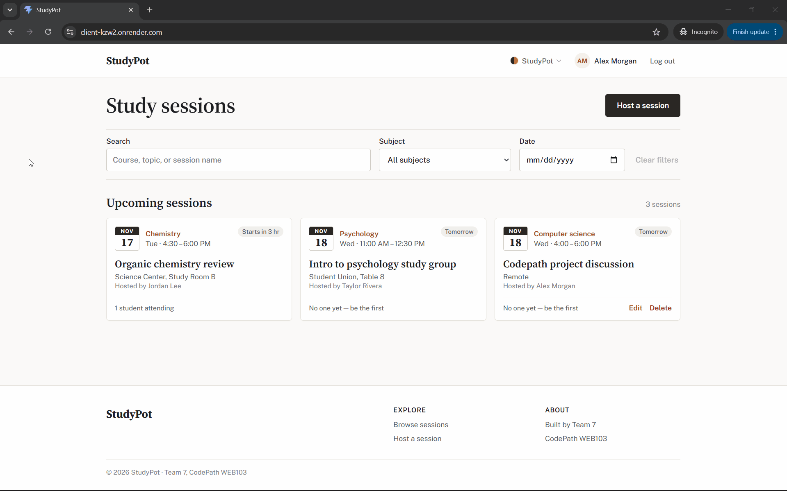

# Milestone 5 — studypot

## Final Checklist

- [x] Added the [Render deployment link](https://client-kzw2.onrender.com/) to `README.md`.
- [x] Confirm that every completed issue has the correct status on our GitHub project board.
- [x] Marked completed features with ✅ in `README.md` and included feature GIFs there.
- [x] Completed the Final Project Feature Checklist below.
- [x] Completed the Reflection below.
- [x] Tested the deployed app from start to finish.
- [x] Added one complete app walkthrough GIF below.

## Final Project Feature Checklist

*Only features implemented in the repository are listed.*

### Baseline Features

- [x] React frontend and Express backend.
- [x] PostgreSQL with one-to-many (host → sessions) and many-to-many (students ↔ sessions, using a membership table) relationships.
- [x] REST API with GET, POST, PATCH, and DELETE for study sessions.
- [x] Database reset/seed script.
- [x] React Router with separate pages and dynamic session routes.
- [x] Reusable React components and interactive updates without page reloads.
- [x] Users can view, create, edit, and delete study sessions.


### Custom Features

- [x] Search and filter sessions by subject and date.
- [x] Form validation for required fields and valid session times.
- [x] Error handling for invalid or failed requests.
- [x] Automatically add the creator as a member of a new session.


### Stretch Features

- [x] Join or leave sessions, with actions changing based on session and user state.
- [x] Loading spinners while data is fetched.
- [x] Disable relevant buttons while actions are processing.
- [x] Toast notifications after actions.

*Note: Demo-account switching is not real authentication or GitHub OAuth, so it is not claimed as an authentication feature.*

## Final Demo GIF

**To finish before submitting:** Record or reuse **one GIF showing a full walkthrough** of all features checked above, save it as `gifs/full_walkthrough.gif`, and replace this instruction with:

```markdown

```

Individual feature GIFs already in the README can be reused; they do not have to be recorded again.

## Reflection


### 1. What went well?

We completed the main study-session features and connected our React frontend, Express backend, and PostgreSQL database. Working on separate tasks helped our team make steady progress.

### 2. What challenges did we face?

Connecting the frontend, backend, and database for deployment was challenging. We also had to manage our time and focus on the core features instead of adding too many new ones.

### 3. What are we most proud of?

We built a full-stack app where students can find, host, join, and manage study sessions. Search, filtering, validation, and notifications made the experience more useful.

### 4. How have we grown as developers?

We learned how to design database relationships, create REST APIs, manage state in React, and collaborate using GitHub issues and pull requests.

### 5. What are our next steps?

We want to add secure authentication, improve testing, and collect feedback from students. We also want to become more confident with deployment and maintaining full-stack applications.