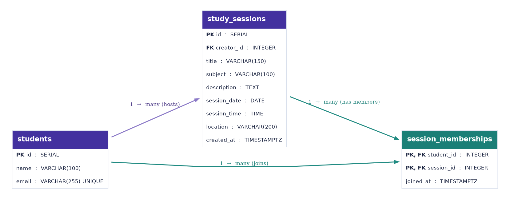

# Entity Relationship Diagram — studypot

CodePath WEB103 Final Project · Milestone 2 (Unit 6)

## Create the List of Tables

1. **`students`** — Stores each student profile. A student can create study sessions and join other students' sessions.
2. **`study_sessions`** — Stores study session details and the student who created each session.
3. **`session_memberships`** — Join table recording which students joined which sessions and when they joined.

## Add the Entity Relationship Diagram

### Table 1 — `students`

| Column | PostgreSQL Type | Key / Requirement | Purpose |
| --- | --- | --- | --- |
| `id` | SERIAL | Primary key | Unique student ID |
| `name` | VARCHAR(100) | NOT NULL | Display name |
| `email` | VARCHAR(255) | UNIQUE, NOT NULL | Student contact / unique identifier |

### Table 2 — `study_sessions`

| Column | PostgreSQL Type | Key / Requirement | Purpose |
| --- | --- | --- | --- |
| `id` | SERIAL | Primary key | Unique session ID |
| `creator_id` | INTEGER | NOT NULL, FK → `students.id` | Student who created session |
| `title` | VARCHAR(150) | NOT NULL | Session name |
| `subject` | VARCHAR(100) | NOT NULL | Subject used for filtering |
| `description` | TEXT | Optional | What the group plans to study |
| `session_date` | DATE | NOT NULL | Session date |
| `session_time` | TIME | NOT NULL | Session start time |
| `location` | VARCHAR(200) | NOT NULL | Where the session meets |
| `created_at` | TIMESTAMPTZ | DEFAULT NOW() | Creation timestamp |

### Table 3 — `session_memberships`

| Column | PostgreSQL Type | Key / Requirement | Purpose |
| --- | --- | --- | --- |
| `student_id` | INTEGER | Composite PK, FK → `students.id` | Who joined |
| `session_id` | INTEGER | Composite PK, FK → `study_sessions.id` | Session joined |
| `joined_at` | TIMESTAMPTZ | DEFAULT NOW() | When the student joined |

The **composite primary key** (`student_id`, `session_id`) prevents the same student from joining a session twice.

## Database Relationships

- **One-to-many:** One `student` can create many `study_sessions`; each session has exactly one `creator_id`.
- **Many-to-many:** A student can join many sessions and a session can have many students. This is implemented with the `session_memberships` join table and its two foreign keys.
- **One-to-many (join table):** One student can have many `session_memberships`; one study session can have many `session_memberships`.

> **Development note:** For the course MVP, we can use seeded sample students or a selected demo student. Authentication is not part of our required feature set. In implementation, ownership and membership mutations should still validate the acting student server-side.

## Planned REST API mapping

| Action | Endpoint | Table(s) |
| --- | --- | --- |
| List and filter sessions | `GET /api/sessions` | `study_sessions`, `students` |
| View session details | `GET /api/sessions/:id` | All three |
| Create session | `POST /api/sessions` | `study_sessions` |
| Edit session | `PATCH /api/sessions/:id` | `study_sessions` |
| Delete session | `DELETE /api/sessions/:id` | `study_sessions` |
| Join session | `POST /api/sessions/:id/members` | `session_memberships` |
| Leave session | `DELETE /api/sessions/:id/members/:studentId` | `session_memberships` |

**Reset database requirement:** During implementation, add a seed/reset script that recreates or restores a default set of students, study sessions, and memberships.

Editable SVG diagram source is included in `planning/erd/studypot-erd.svg`.
