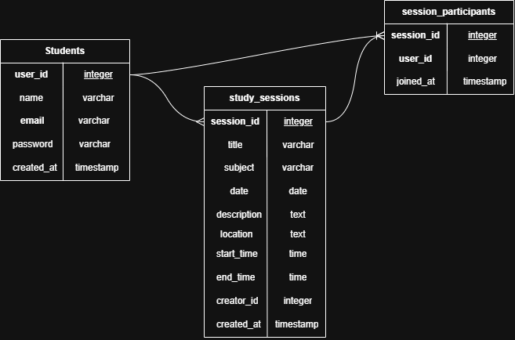

# Entity Relationship Diagram

Reference the Creating an Entity Relationship Diagram final project guide in the course portal for more information about how to complete this deliverable.

## Create the List of Tables

- **students**: students who use Studypot
- **study_sessions**: study sessions created by students
- **session_participants**: join table linking students to the sessions they joined

**Relationships**

- One student can create many study sessions (`students` 1 → many `study_sessions`, via `creator_id`).
- Students and study sessions have a many-to-many relationship through `session_participants`: a student can join many sessions, and a session can have many students.

## Add the Entity Relationship Diagram

### students

| Column Name | Type | Description |
|-------------|------|-------------|
| user_id | integer | primary key |
| name | varchar | student's full name |
| email | varchar | student's email address (unique) |
| password | varchar | hashed password |
| created_at | timestamp | when the account was created |

### study_sessions

| Column Name | Type | Description |
|-------------|------|-------------|
| session_id | integer | primary key |
| title | varchar | title of the study session |
| subject | varchar | subject being studied |
| date | date | date of the session |
| description | text | details about the session |
| location | text | where the session takes place |
| start_time | time | when the session starts |
| end_time | time | when the session ends |
| creator_id | integer | foreign key → `students.user_id` (the organizer) |
| created_at | timestamp | when the session was created |

### session_participants

| Column Name | Type | Description |
|-------------|------|-------------|
| session_id | integer | foreign key → `study_sessions.session_id`; part of composite primary key |
| user_id | integer | foreign key → `students.user_id`; part of composite primary key |
| joined_at | timestamp | when the student joined the session |
