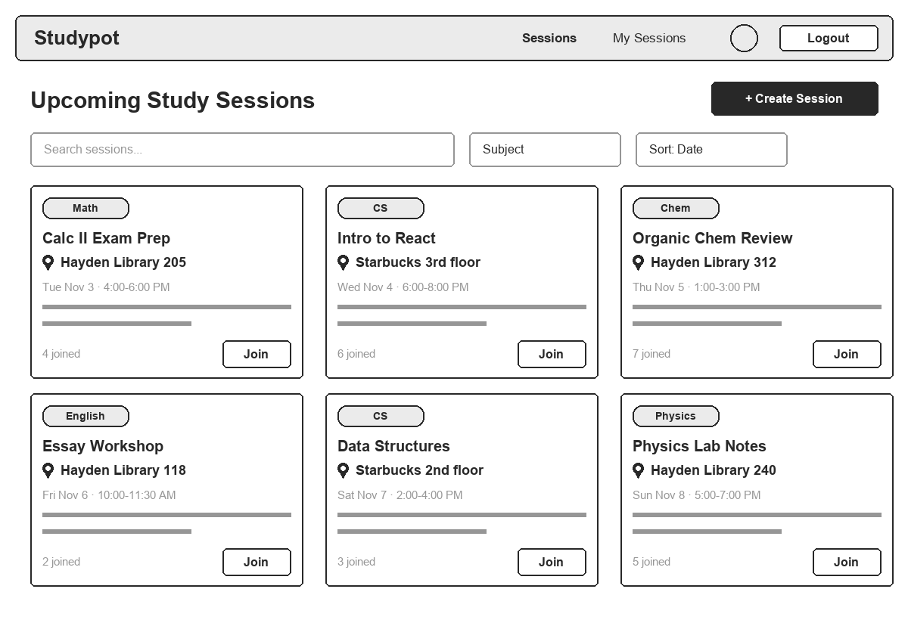
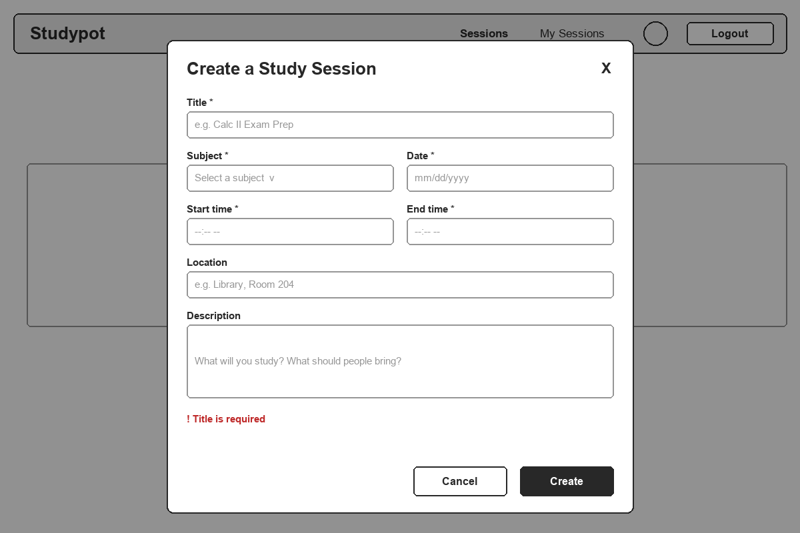
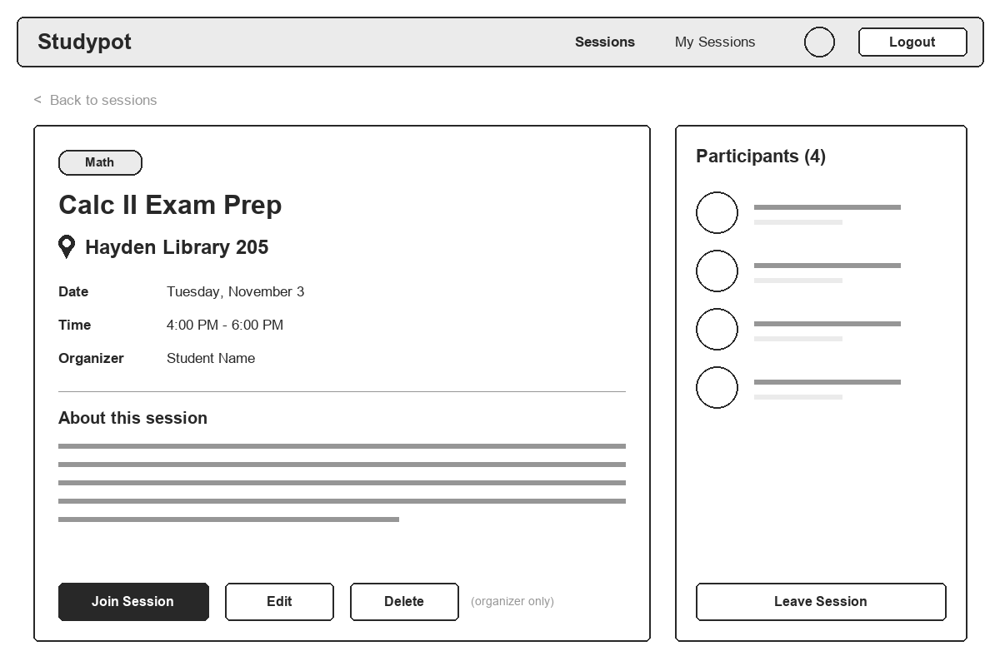

# Wireframes

Reference the Creating an Entity Relationship Diagram final project guide in the course portal for more information about how to complete this deliverable.

## List of Pages

- ⭐ **Dashboard** (`/`): browse upcoming study sessions, search, filter by subject, and sort by date
- ⭐ **Create Session** (modal on the dashboard): form to create a new study session without leaving the page
- ⭐ **Session Details** (`/sessions/:id`): full session info, participant list, and join / leave / edit / delete actions
- **Edit Session** (`/sessions/:id/edit`): pre-filled form for the organizer to update a session
- **My Sessions** (`/my-sessions`): sessions the student organized or joined
- **Not Found** (`*`): 404 page for unknown routes

## Wireframe 1: Dashboard

## Wireframe 2: Create Session Modal

## Wireframe 3: Session Details

