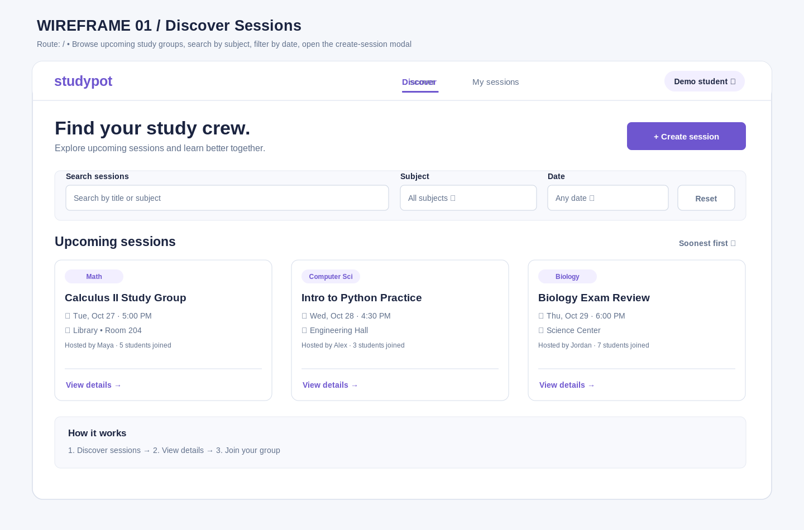
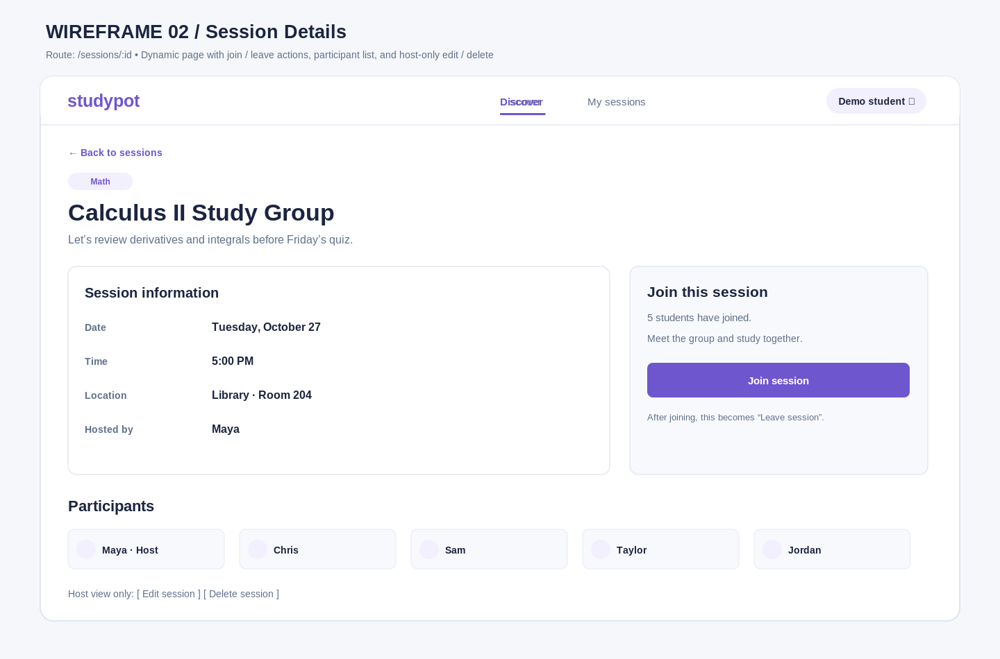
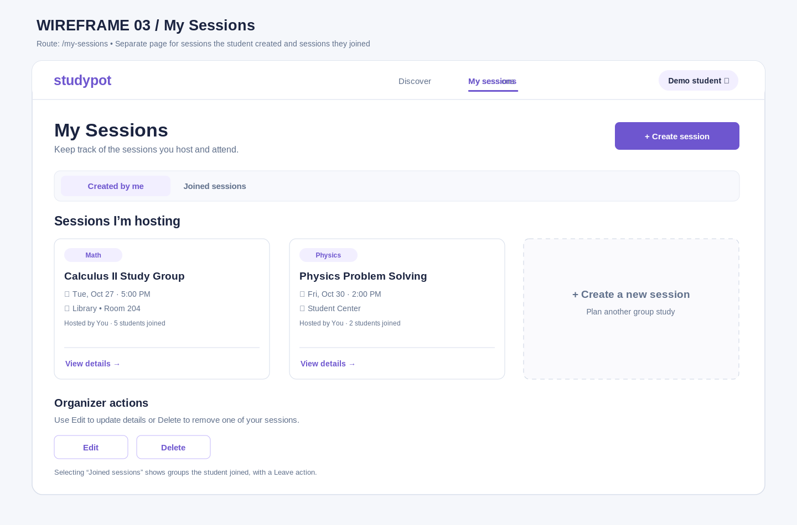
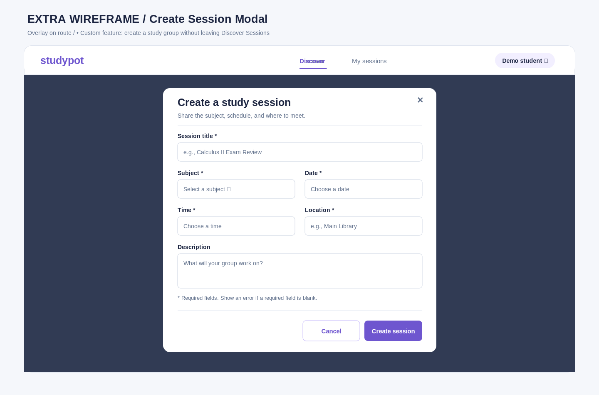

# Wireframes — studypot

CodePath WEB103 Final Project · Milestone 2 (Unit 6)

## List of Pages

- ⭐ **Discover Sessions** — `/` — Browse upcoming sessions, search, filter by subject/date, and open the create-session modal.
- ⭐ **Session Details** — `/sessions/:id` — See the full study-group details, members, and join/leave actions.
- ⭐ **My Sessions** — `/my-sessions` — View study sessions the student hosts and has joined; edit/delete hosted sessions.

**Additional interaction:** The Create Session modal is an overlay on the Discover page, not a fourth route. The modal is included as an extra wireframe below.

## Wireframe 1: Discover Sessions

**Interactions:** Search by title or subject; filter by subject and date; sort by soonest; open session detail via “View details”; open the create-session modal.

## Wireframe 2: Session Details

**Interactions:** Join or leave a session on the same page, view participants, and show Edit/Delete actions only for sessions the selected student created.

## Wireframe 3: My Sessions

**Interactions:** Switch between “Created by me” and “Joined sessions”; edit or delete owned sessions; leave joined sessions. Any changes should be reflected in the dashboard and details pages.

## Additional Wireframe: Create Session Modal

**Interactions:** Create a session without changing the page URL. Validate required fields; closing or canceling dismisses the modal; submitting sends a POST request and updates the Discover page.

## Navigation and implementation notes

- Top navigation: **Discover** (`/`) and **My sessions** (`/my-sessions`).
- Each session card links to `/sessions/:id` (a dynamic React Router route).
- The Create Session button opens the form modal; it does not navigate to a new route.
- All drawings are **planning wireframes**, not screenshots of an implemented app.
- The illustrations use example content for layout purposes. The finished app will load sessions from PostgreSQL through the Express REST API.
- Editable vector originals are saved alongside each PNG inside `planning/wireframes/`.
